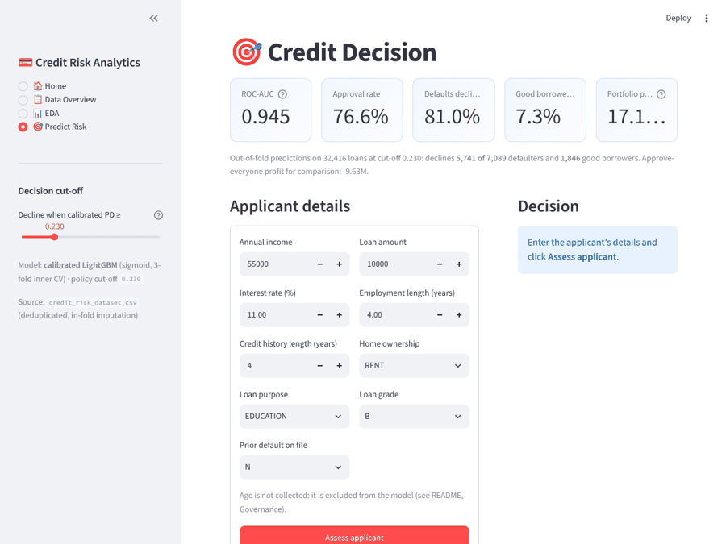
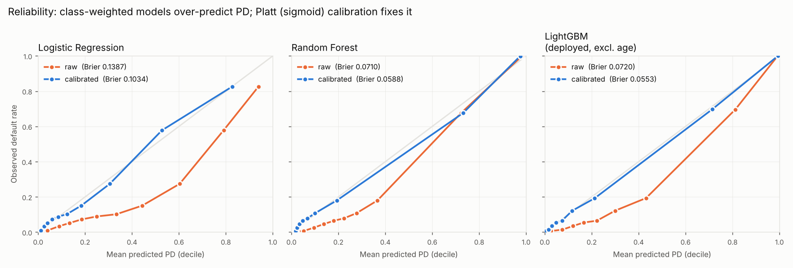
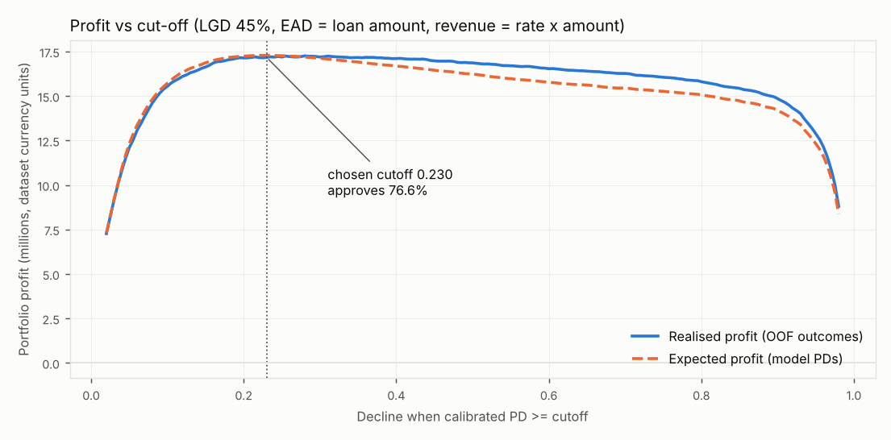
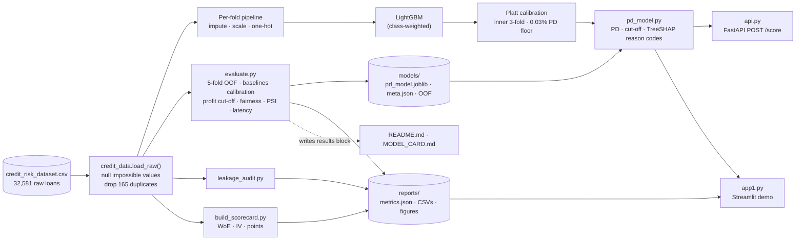

# Credit Risk Prediction — a calibrated credit decision system

Predicts probability of default (PD) on 32,416 consumer loans, turns it into an approve/decline decision by **maximising expected profit**, explains every decline with **reason codes**, and serves it through a **FastAPI** endpoint and a **Streamlit** demo. Built on a [leakage audit](#leakage-audit) that every number below inherits.

**Live demo:** [credit-risk-prediction-ml1.streamlit.app](https://credit-risk-prediction-ml1.streamlit.app/)



## In four lines

1. **Metric:** ROC-AUC 0.945 (Gini 0.89) on 5-fold out-of-fold predictions, plus a Brier score of 0.055 against a 0.171 baseline, because a lender prices on the probability, not the rank.
2. **Business number:** at the profit-maximising cut-off the policy approves 76.6% of applicants, declines 81.0% of defaults, and earns 17.2M against -9.6M for approving everyone (LGD 45%).
3. **What can mislead:** the dataset has no dates, so there is no out-of-time test and the PSI figures are only a mechanism check; `loan_grade` and `loan_int_rate` are the lender's own underwriting outputs; and only approved loans have outcomes, so reject inference is missing.
4. **Next:** obtain dated data for an out-of-time test, rerun without underwriting outputs on application-only data, and run a small random-approval experiment to learn about declined applicants.

<!-- RESULTS:START - generated by evaluate.py; do not edit by hand -->
## Results

All figures: **stratified 5-fold cross-validation, out-of-fold predictions**, 32,416 loans after deduplication, **default rate 21.87%**. Every transform, the model and the Platt (sigmoid) calibrator are refit inside each fold. PDs carry the Basel 0.03% floor. Regenerate with `make eval`.

### Headline

| Metric | Value | Split |
|---|---|---|
| ROC-AUC (deployed, calibrated LightGBM) | 0.9449 ± 0.0034 | 5-fold CV |
| Gini | 0.8898 | 5-fold CV |
| KS | 0.7399 | 5-fold OOF |
| PR-AUC (baseline = default rate 0.2187) | 0.8976 | 5-fold CV |
| Brier score (baseline 0.1709) | 0.0553 | 5-fold CV |
| Cut-off (decline if PD >=) | 0.230 | chosen on expected profit, no outcomes used |
| Approval rate at cut-off | 76.6% | 5-fold OOF |
| Defaults declined (recall) / precision | 81.0% / 75.7% | 5-fold OOF |
| Realised profit vs approve-everyone | 17.18M vs -9.63M | 5-fold OOF, LGD 45% |
| Expected loss of approved book | 5.36M | model PD x LGD x EAD |
| Scoring latency p50 / p95 (HTTP) | 36.9 / 52.9 ms | 1 applicant, localhost |

Money is in the dataset's own currency units: the Kaggle file does not label its currency, so no rupee or dollar conversion is applied.

### Models vs baselines

| Model | ROC-AUC | Gini | PR-AUC | KS | Brier (raw -> calibrated) | Mean PD (raw -> cal.) |
|---|---|---|---|---|---|---|
| Majority class (baseline) | 0.5000 | 0.0000 | 0.2187 | 0.0000 | 0.1709 | 0.219 |
| Logistic Regression | 0.8707 ± 0.0034 | 0.7415 | 0.7172 | 0.6038 | 0.1387 -> 0.1034 | 0.381 -> 0.219 |
| WoE Scorecard | 0.8700 ± 0.0033 | 0.7400 | 0.7136 | 0.6119 | 0.1046 -> 0.1046 | 0.219 -> 0.219 |
| Random Forest | 0.9342 ± 0.0022 | 0.8684 | 0.8851 | 0.7255 | 0.0710 -> 0.0588 | 0.306 -> 0.220 |
| LightGBM (all features) | 0.9473 ± 0.0025 | 0.8946 | 0.9015 | 0.7457 | 0.0703 -> 0.0540 | 0.314 -> 0.221 |
| **LightGBM deployed (excl. age)** | 0.9449 ± 0.0034 | 0.8898 | 0.8976 | 0.7399 | 0.0720 -> 0.0553 | 0.315 -> 0.221 |

ROC-AUC, Gini, PR-AUC and KS are shown for the calibrated variant; Platt (sigmoid) calibration is monotone, so ranking metrics barely move. Raw `class_weight="balanced"` models rank well but overstate PD, which the Brier and Mean-PD columns expose.



**Why Platt, not isotonic** (deployed model, 5-fold CV):

| Method | ROC-AUC | Brier | Brier std | ECE | PD exactly 0 (<=1e-4) | PD exactly 1 (>=0.9999) | Distinct PD levels |
|---|---|---|---|---|---|---|---|
| isotonic | 0.9446 | 0.0550 | 0.0024 | 0.0031 | 3,762 | 3,452 | 358 |
| sigmoid | 0.9449 | 0.0553 | 0.0024 | 0.0072 | 489 | 0 | 27,781 |

Brier is a tie within one standard deviation. Isotonic's step function assigns PD = 0 or 1 to thousands of applicants, which cannot be priced or explained; sigmoid gives a continuous PD.

### Decision policy

| Policy | Approval rate | Defaults declined (recall) | Precision (declined who default) | Good borrowers declined | Bad rate in approved book | Realised loss | Realised profit |
|---|---|---|---|---|---|---|---|
| Approve everyone | 100.0% | 0.0% | 0.0% | 0.0% | 21.9% | 34.64M | -9.63M |
| Old app: uncalibrated LightGBM @ 0.50 | 78.9% | 79.1% | 81.9% | 4.9% | 5.8% | 6.01M | 17.30M |
| Deployed: calibrated PD < 0.230 (expected-profit cutoff) | 76.6% | 81.0% | 75.7% | 7.3% | 5.4% | 5.47M | 17.18M |
| Per-loan break-even: PD < rate/(rate+LGD) | 75.5% | 81.8% | 73.0% | 8.5% | 5.3% | 5.35M | 17.24M |
| Oracle: deployed model, best realised cutoff 0.280 (hindsight) | 79.0% | 78.7% | 82.1% | 4.8% | 5.9% | 6.08M | 17.26M |

Confusion matrix at the deployed cut-off (positive = default, predicted positive = declined):

| | Approved | Declined |
|---|---|---|
| **Repaid** | 23,481 | 1,846 |
| **Defaulted** | 1,348 | 5,741 |



### Governance

**Fairness by age band** (age is not a model input; bands with < 300 applicants excluded from gaps):

| band | Applicants | Actual default rate | Mean predicted PD | Approval rate | Approval rate among good borrowers | Default rate in approved |
|---|---|---|---|---|---|---|
| 20-25 | 15,245 | 23.1% | 23.2% | 75.4% | 92.7% | 5.5% |
| 26-35 | 13,711 | 20.7% | 21.1% | 77.5% | 92.4% | 5.5% |
| 36-45 | 2,809 | 20.7% | 20.7% | 78.7% | 94.3% | 4.9% |
| 46-55 | 512 | 21.9% | 20.7% | 77.9% | 93.8% | 6.0% |
| 56+ | 134 | 23.9% | 27.1% | 69.4% | 89.2% | 2.2% |

Max gap across bands: approval rate **3.3 pp**, actual default rate 2.5 pp, approval among good borrowers 2.0 pp.

**Stability** (holdout 80/20 split; PSI < 0.10 stable, 0.10-0.25 monitor, > 0.25 retrain):

| Variable | Type | PSI | Status |
|---|---|---|---|
| Model score (PD) | score | 0.0007 | stable |
| loan_percent_income | CSI | 0.0024 | stable |
| person_home_ownership | CSI | 0.0002 | stable |
| person_income | CSI | 0.0026 | stable |
| loan_intent | CSI | 0.0024 | stable |
| loan_int_rate | CSI | 0.0020 | stable |

These are near zero by construction: the split is random, not time-ordered. They prove the monitoring code works, not that the model is stable over time.

**Top reason codes** (most common first reason among declined holdout applicants): loan_percent_income 35%, loan_grade 23%, person_income 23%. Sample in `reports/reason_codes_sample.csv`.

### System

| Factor | Value |
|---|---|
| Training time, final calibrated model | 1.8 s (32,416 rows, 10 features) |
| Model artifact | 0.15 MB (joblib, compressed) |
| Latency p50 / p95: PD only (predict_pd) | 11.48 / 15.52 ms |
| Latency p50 / p95: PD + decision + reason codes | 28.48 / 43.16 ms |
| Latency p50 / p95: FastAPI /score (in-process) | 38.32 / 53.16 ms |
| Latency p50 / p95: FastAPI /score over HTTP (uvicorn, localhost) | 36.88 / 52.92 ms |
| Peak memory, full evaluation | 470 MB |
| Hardware | Intel(R) Xeon(R) Processor @ 2.80GHz, 2 cores |
| Data | 1.8 MB CSV, fits in memory; no GPU |
| `evaluate.py` runtime (the full `run_eval.py` also runs the audit and scorecard) | 4.3 min |
<!-- RESULTS:END -->

---

## Architecture



`pd_model.py` is the single scoring path: the API, the demo and the evaluation all call it, so they cannot disagree about a decision. `make eval` regenerates every number in this README.

---

## What the evaluation found

1. **The leakage was real but worth almost nothing.** Pre-split imputation and 165 duplicate rows moved Random Forest from 0.9352 to 0.9342 ROC-AUC, inside the ±0.0022 fold noise. The strength comes from `loan_grade` and `loan_int_rate` (below).
2. **Every class-weighted model over-predicted PD by 40–74%.** `class_weight="balanced"` buys ranking at the cost of probabilities. Platt calibration brings the mean PD back to the true default rate. The WoE scorecard was calibrated out of the box, which is one reason banks keep scorecards.
3. **Isotonic calibration was rejected.** Its Brier score ties Platt's, but its step function scored thousands of applicants at PD = 0 or 1 exactly, which can be neither priced nor explained.
4. **Calibration did not add profit; it made the PD usable.** The calibrated cut-off makes slightly *less* realised profit than the old uncalibrated 0.50 cut-off — within 1%, and the old model still used age. The near-tie is not luck: class weighting rescales odds by ≈ 0.78/0.22, so a raw 0.50 lands near a calibrated 0.22, almost exactly the break-even PD at typical rates. What calibration buys is a cut-off chosen **without looking at outcomes**, plus an expected-loss figure you can price with.
5. **Many declines cite the lender's own grade or rate as the first reason.** These are underwriting outputs, so "your risk grade is D" explains nothing to an applicant. An application-only model is the honest version for new-to-bank decisions (see Limitations).

---

## Leakage audit

Run `python leakage_audit.py` → `reports/leakage_ablation.csv`, `reports/feature_audit.csv`.

| Check | Verdict | Evidence |
|---|---|---|
| Preprocessing fitted before the split | **Leak confirmed** | `EDA.ipynb` mean-imputed the full file before splitting: 895 `person_emp_length` and 3,114 `loan_int_rate` rows held the exact full-data mean |
| Duplicates spanning train and test | **Leak confirmed** | 165 exact duplicate rows; ~51.6 test rows per fold had a twin in their training fold |
| Features recorded after the outcome | **None** | `loan_grade` and `loan_int_rate` flagged as underwriting outputs, not post-outcome |

| Configuration | Model | CV ROC-AUC | KS |
|---|---|---|---|
| 1. Leaky baseline (pre-imputed + duplicates) | Random Forest | 0.9352 ± 0.0039 | 0.7280 |
| 2. In-fold imputation, duplicates remain | Random Forest | 0.9339 ± 0.0051 | 0.7246 |
| 3. Corrected (in-fold + deduplicated) | Logistic Regression | 0.8707 ± 0.0034 | 0.6036 |
| 3. Corrected (in-fold + deduplicated) | Random Forest | 0.9342 ± 0.0022 | 0.7255 |
| 4. Corrected, application-only (no grade/rate) | Logistic Regression | 0.8062 ± 0.0038 | 0.4589 |
| 4. Corrected, application-only (no grade/rate) | Random Forest | 0.8740 ± 0.0042 | 0.5864 |

The near-vertical start of the ROC curve is genuine, not leakage: grade G loans default at 98.4%.

## WoE scorecard

Run `python build_scorecard.py` → `reports/iv_table.csv`, `reports/scorecard.csv` (points per bin), `reports/cutoff_analysis.csv`.

Weight-of-evidence binning is refit inside each fold. A logistic regression on the WoE values is scaled to **base 600 at 50:1 odds, PDO 20**. CV ROC-AUC is **0.8700 ± 0.0033**, KS **0.6119**. The top three features by Information Value are `loan_grade` 0.8790, `loan_percent_income` 0.7079 and `loan_int_rate` 0.6192. All three are flagged suspicious (IV > 0.5), and two of them are the underwriting outputs above.

**Why a bank might still choose the scorecard over the 0.94-AUC LightGBM:** it is calibrated without a correction step, each point is auditable per bin, it is monotone by construction, and it is stable to explain to a regulator. The cost is about 0.075 ROC-AUC.

---

## Limitations

- **No out-of-time test.** The dataset has no application or booking date, so every split is random. Banks trust out-of-time AUC because performance usually drops when the economy or applicant mix shifts; random CV cannot show that drop. Treat all numbers here as an upper bound.
- **The PSI numbers do not show stability.** They compare a random 80/20 split, so they are near zero by construction. The code computes PSI and CSI correctly and will flag a real shift once dated data exists.
- **Underwriting outputs as inputs.** `loan_grade` and `loan_int_rate` are produced by the lender's own risk process. With them, the model partly learns the underwriter's opinion. Without them, application-only ROC-AUC falls from 0.9342 to 0.8740 (Random Forest).
- **Reject inference is not done.** Only loans that were approved have an outcome, so the model has never seen the applicants the original lender declined. Those applicants were declined because they looked riskier, and the model is likely too optimistic about them. A new decision policy would approve people outside the training population, which is exactly where it is least reliable. Fixes such as augmentation, parcelling or a small random-approval experiment all need data this project does not have.
- **The profit model is a simplification.** LGD is assumed at 45% (Basel foundation-IRB, senior unsecured) rather than estimated, EAD is the full principal, revenue is one period of gross interest, and there are no funding, servicing or acquisition costs. Missing interest rates (3,095 loans) are filled with the grade median for the accounting only. Currency is the dataset's own unlabelled unit.
- **The fairness check is narrow.** Age is the only protected attribute available. Age is excluded as an input, but `cb_person_cred_hist_length` is a strong proxy for it. The 56+ band (n = 134) is too small for the 10 pp rule and is reported separately.
- **Dataset provenance is unknown.** This is a public Kaggle file with no documentation of how it was collected, sampled or generated.
- **The system figures come from a 2-core cloud container.** Production latency depends on hardware, concurrency and network. The one-applicant numbers are a floor, not a capacity figure.
- **Production gaps.** There is no authentication on the API, no request logging or drift alerting, no champion–challenger testing, and no model registry. On Streamlit Cloud, the app retrains at startup if the saved model's scikit-learn version cannot be loaded.

---

## How to run

```bash
pip install -r requirements-dev.txt   # app + API + evaluation dependencies

python run_eval.py                    # regenerates EVERY number in this README
#   or: make eval                     # same thing, if make is installed

streamlit run app1.py                 # demo at http://localhost:8501
uvicorn api:app --port 8000           # API; docs at http://localhost:8000/docs
```

Score one applicant:

```bash
curl -X POST http://localhost:8000/score -H "Content-Type: application/json" -d '{
  "person_income": 42000, "person_home_ownership": "RENT", "person_emp_length": 3,
  "loan_intent": "MEDICAL", "loan_grade": "D", "loan_amnt": 15000, "loan_int_rate": 15.2,
  "cb_person_default_on_file": "N", "cb_person_cred_hist_length": 4}'
```

Returns PD, decision, cut-off, break-even PD, expected loss and profit, and the top three reason codes.

## Project structure

```
credit_data.py        shared leak-free loader + preprocessing pipeline
pd_model.py           deployed model: calibration, PD floor, decision rule, reason codes
woe.py                fold-safe WoE / IV transformer
evaluate.py           models vs baselines, calibration, profit cut-off, fairness, PSI, latency
leakage_audit.py      leakage checks + ablation
build_scorecard.py    WoE scorecard, IV table, points scaling
run_eval.py           runs all of the above in order, then verify_readme.py
verify_readme.py      checks the README's hand-written numbers against generated files
api.py                FastAPI scoring endpoint
app1.py               Streamlit demo
models/               pd_model.joblib, pd_model_meta.json, out-of-fold predictions
reports/              metrics.json, CSVs, figures (all generated)
docs/demo.gif         30-second walkthrough of the Streamlit demo
MODEL_CARD.md         intended use, data, metrics, limitations, owners
```

See [`MODEL_CARD.md`](MODEL_CARD.md) for the governance summary.

## Author

Yash Shelke — [GitHub](https://github.com/yashshelke2106)
